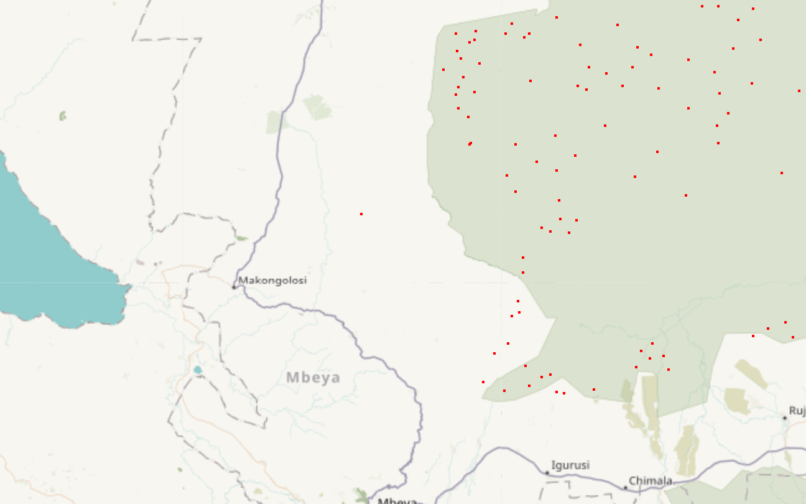

# WU XIAQIN — Data Science Portfolio

**Student ID:** MC659782
**Programme:** Master of Science in Computer Science (CISC7204 Data Science and Data Visualization)

## About Me

I am a data science student interested in turning messy real-world data into
clear, interactive visual stories. I enjoy working with Python for data
analysis and have been learning how interactive map visualizations can reveal
spatial patterns that tables and static charts hide.

## Technical Skills

- **Languages & Libraries:** Python, pandas, NumPy, SciPy
- **Visualization:** Matplotlib, Seaborn, Geoplotlib (interactive maps), Bokeh (in progress)
- **Environment & Tools:** Jupyter Notebook / JupyterLab, Anaconda, Git, GitHub

## Project Showcase

### Geospatial Data Visualization with Python (Geoplotlib)

**Project title and research question:** How do interactive maps reveal spatial
patterns in real-world data? The project visualizes wildlife poaching
incidents in Tanzania, US state land-area distribution, and world city
clusters using Geoplotlib.

**Findings:** Poaching incidents cluster in the central–western region of
Tanzania (Igurusi, Chimala, Mbeya area) rather than spreading uniformly — the
dot and histogram layers make the concentration immediately visible. A US
choropleth highlights how a single attribute (land area) can drive an entire
color map, and a Delaunay triangulation of European cities shows dense
clusters around Germany and the UK.

**Project repository:** [https://github.com/wu-xiaqin/data-science-project](https://github.com/wu-xiaqin/data-science-project)

**Current project status:** Completed

## Contact

UM student account: MC659782 (WU XIAQIN)
